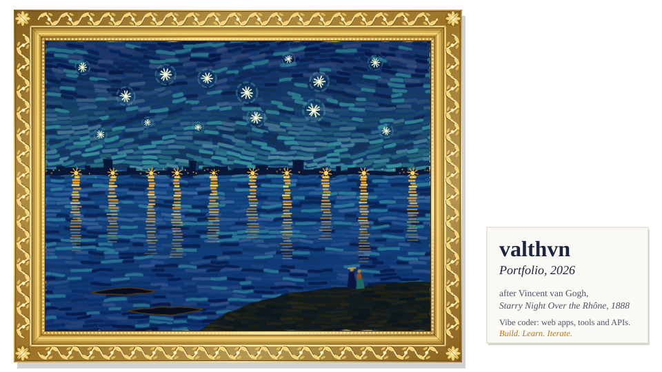
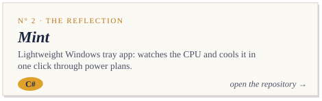
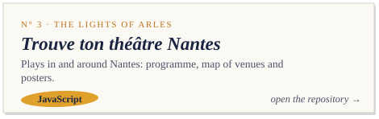
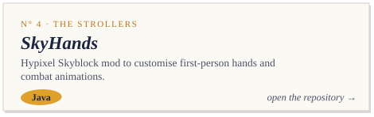
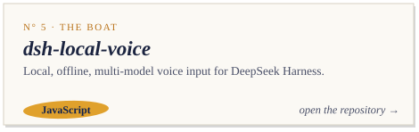
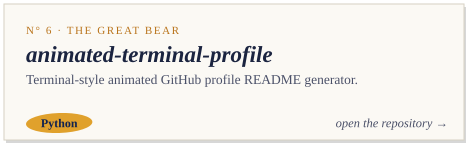
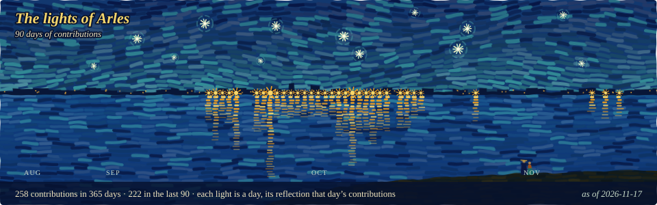

<!-- VALTHVN / SESSION 006 -->



<a href="https://github.com/valthvn/GoodByeFirewall"></a> <a href="https://github.com/valthvn/Mint"></a><br>
<a href="https://github.com/valthvn/trouve-ton-theatre-nantes"></a> <a href="https://github.com/valthvn/SkyHands"></a><br>
<a href="https://github.com/valthvn/dsh-local-voice"></a> <a href="https://github.com/valthvn/animated-terminal-profile"></a><br>

<details>
<summary><em>The studio</em> — stack</summary>

```json
{
  "languages": ["Python", "TypeScript", "JavaScript"],
  "frontend": ["React", "Next.js", "Tailwind CSS"],
  "backend": ["FastAPI", "Node.js", "Express"],
  "tools": ["Docker", "Git", "Linux", "GitHub Actions"]
}
```

</details>

<br>



<details>
<summary><em>Visitor’s guide</em></summary>

**The painting**: the profile is one room of a museum; the picture is the portfolio.
**The labels**: each project hangs under an element of the scene; click a label to open its repository.
**The lights of Arles**: real public contributions, one light per day, refreshed daily.

</details>
